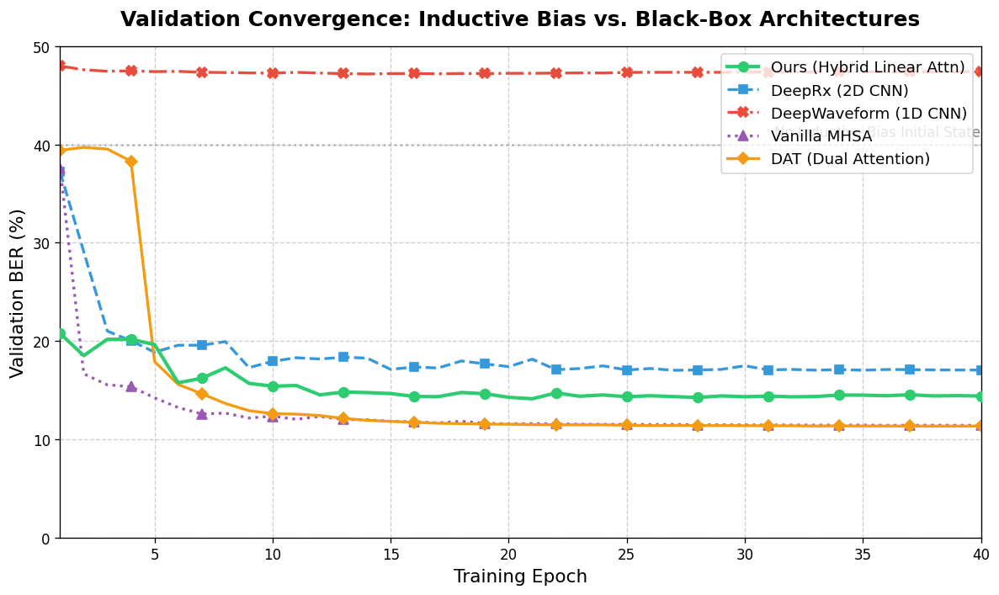
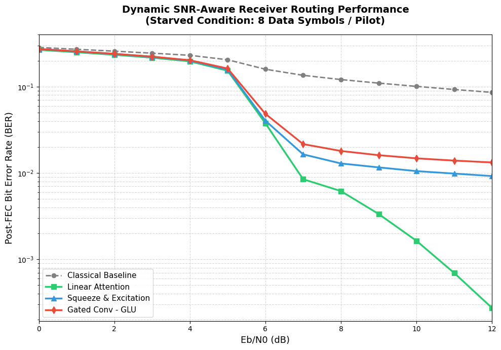
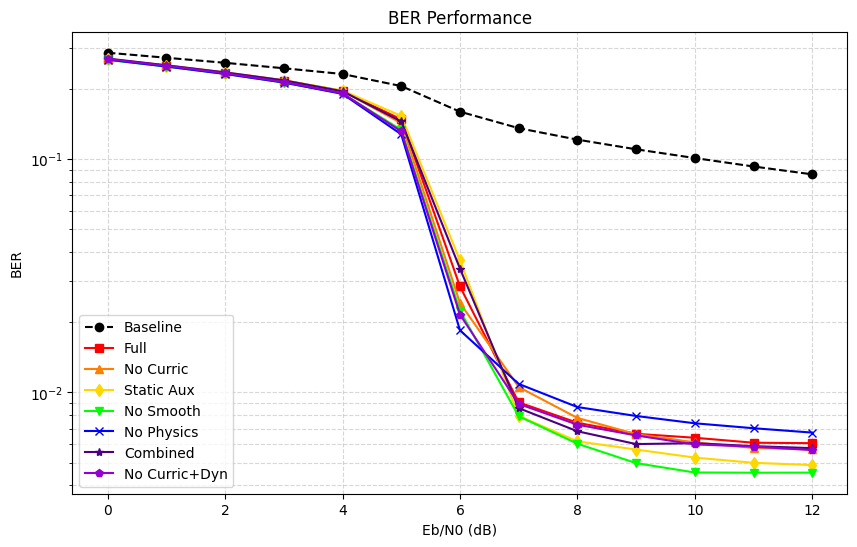
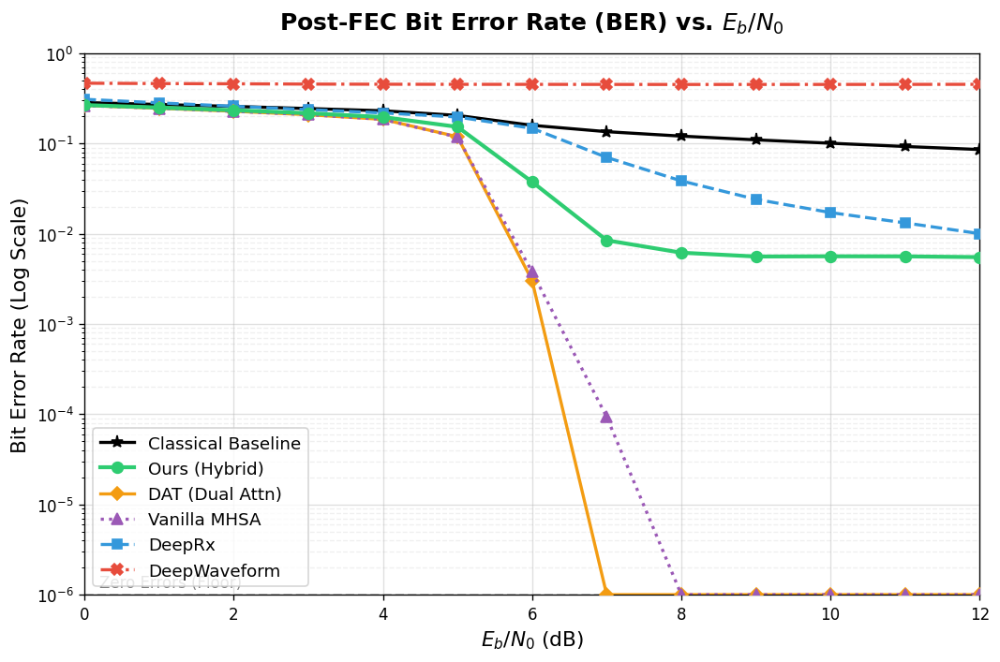
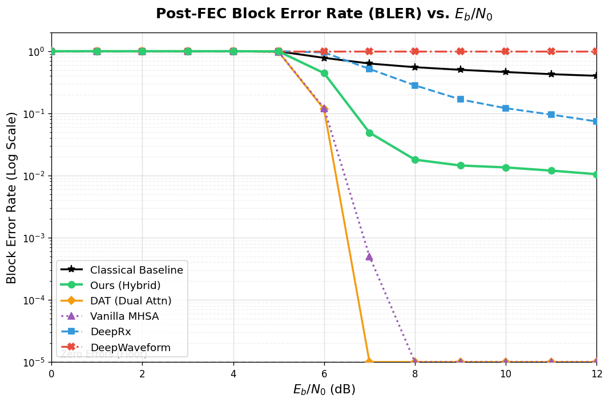
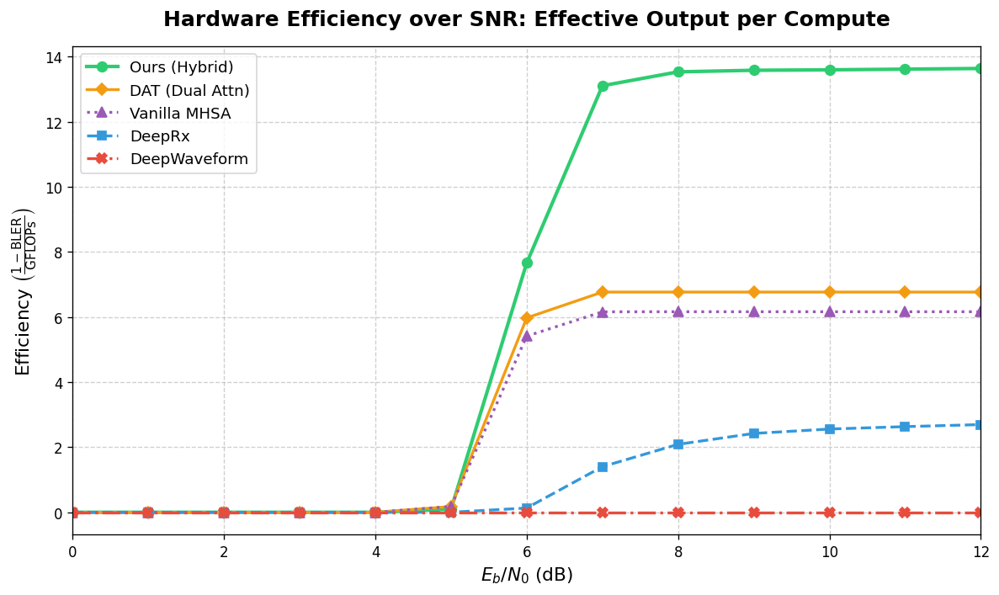
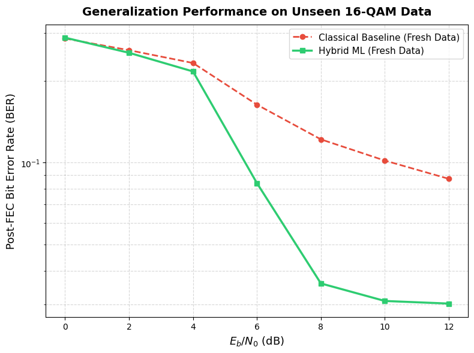

# Lightweight Physics-Informed Hybrid Receiver for Pilot-Starved OFDM Systems via Linear Attention

---

#### Authors:

> [Kevin Giannandrea](https://github.com/giankev) \
> [Leonardo Mariut](https://github.com/ErBlurk)

Sapienza University of Rome

---

- [Quick overview](#quick-overview)
- [Pilot starvation](#pilot-starvation)
- [Proposed receiver](#proposed-receiver)
- [Experimental setup](#experimental-setup)
- [Results](#results)
- [Main Notebooks](#main-notebooks)
- [Environment setup](#environment-setup)
- [Project structure & reproduction](#project-structure--reproduction)
- [Future work](#future-work)

---

### Quick overview

We developed a lightweight hybrid neural receiver for digital communications, combining physical signal correction with learned parameter estimation and Linear Attention. The project focuses on recovering coded 16-QAM signals affected by phase offset, Carrier Frequency Offset (CFO) and additive noise, especially when very few pilot symbols are available.

The network estimates the physical impairments, applies differentiable signal correction and produces soft bits for a standard 5G LDPC decoder. This keeps the known signal processing operations inside the model while using neural networks for estimation and residual correction.

The repository includes single-carrier experiments, OFDM with two different pilot densities, architecture comparisons and training ablations. The main experiment uses **1 pilot for every 8 data OFDM symbols**, comparing our Linear Attention receiver against classical DSP and several neural baselines.

---

### Pilot starvation

Pilot symbols give the receiver a known reference for estimating how the channel has changed the transmitted signal. Using fewer pilots leaves more bandwidth for data, but also makes synchronization more difficult.

Here, a single pilot OFDM symbol is placed before the data. Increasing the payload from 2 to 8 data symbols means that the same reference must support a much longer frame. Small CFO estimation errors accumulate into phase drift across the data, making pilot-only correction unreliable under noise.

Neural receivers can use information from both pilots and data, but their computational cost also matters. Standard self-attention builds a matrix of interactions between all sequence positions, with quadratic cost as the sequence grows. Our attention block aggregates global information without constructing this full matrix.

---

### Proposed receiver

The receiver processes the signal through the following stages:

* **Parameter estimation:** an MLP receives the pilot and data I/Q samples and estimates phase offset and CFO.
* **Physical compensation:** differentiable de-rotation corrects the received samples before cyclic prefix removal and an orthonormal FFT.
* **Feature extraction:** residual Conv1D blocks and Linear Attention process the frequency-domain signal. FiLM conditioning uses the estimated physical parameters to adjust the features.
* **Soft-bit prediction:** a neural demapper produces four bit logits per 16-QAM symbol. The calibrated outputs are passed to the 5G LDPC decoder.
* **Auxiliary reconstruction:** an additional head predicts clean I/Q symbols to guide training.

The model is trained with bit classification, parameter regression and I/Q reconstruction losses. Teacher forcing is gradually removed during the first 10 epochs, so the downstream receiver initially sees ground-truth parameters before relying on its own estimates. Label smoothing and gradient clipping help stabilize training.



*Validation BER over training epochs for the hybrid receiver and neural baselines.*

#### SNR-aware routing:

The fully neural path performs well in the target noise range, but reaches an error floor at high SNR. The notebooks also evaluate a classical-assisted path that supplies classical parameter estimates to the same neural receiver.

The routing experiment switches between these two paths at **9 dB**, based on the crossing of their measured BER curves. The neural demapper remains active in both cases. This is an algorithmic comparison using the simulation's known Eb/N0, with the threshold selected from the evaluated curves.

---

### Experimental setup

The communication link is generated with NVIDIA Sionna and TensorFlow, while the neural receivers are implemented in PyTorch. Phase offset, CFO and complex AWGN are applied explicitly in the simulator.

| Parameter | Standard OFDM | Pilot-starved OFDM |
| --- | --- | --- |
| Pilot / data OFDM symbols | 1 / 2 | 1 / 8 |
| FFT size / cyclic prefix | 64 / 16 samples | 64 / 16 samples |
| Total frame length | 240 time samples | 720 time samples |
| Data modulation | 16-QAM | 16-QAM |
| Pilot modulation | QPSK | QPSK |
| LDPC information / coded bits | 256 / 512 | 1024 / 2048 |
| Code rate | 1/2 | 1/2 |
| Decoder | 5G LDPC, Min-Sum, 15 iterations | 5G LDPC, Min-Sum, 15 iterations |

* Phase offset is sampled between **-π and π**.
* CFO is sampled between **-2e-4 and 2e-4 cycles/sample** in the simulator.
* Eb/N0 covers **0 to 12 dB**, accounting for pilot and cyclic prefix overhead.
* The training pool contains **10,000 frames**: 8,000 in the 4 to 8 dB target range and 2,000 across the full range. The notebooks split this pool into 85% training and 15% validation.
* Training uses **AdamW**, a learning rate of **2e-3**, weight decay of **1e-4**, batch size **128** and **40 epochs** with cosine annealing.

The classical baseline uses a pilot-only CFO grid search and phase estimation, followed by deterministic compensation, APP demapping and LDPC decoding. Oracle experiments supply ground-truth parameters to separate estimation errors from the remaining receiver processing.

---

### Results:

#### Pilot-starved reception:

Post-FEC BER comparison under the 1:8 pilot configuration, as reported in the project report:

| Receiver | BER @ 0 dB (↓) | BER @ 4 dB (↓) | BER @ 8 dB (↓) | BER @ 12 dB (↓) |
| --- | --- | --- | --- | --- |
| Classical baseline | 2.85e-1 | 2.31e-1 | 1.21e-1 | 8.59e-2 |
| GLU Hybrid | 2.74e-1 | 2.03e-1 | 1.80e-2 | 1.33e-2 |
| SE Hybrid | 2.73e-1 | 2.01e-1 | 1.29e-2 | 9.22e-3 |
| LA Hybrid (Ours, with routing) | **2.67e-1** | **1.97e-1** | **6.17e-3** | **2.73e-4** |



*Post-FEC BER under 1:8 pilot density. The LA curve includes the switch to classical-assisted estimation at 9 dB.*

* **BER** measures the fraction of incorrectly decoded information bits. **BLER** measures the fraction of information blocks containing at least one error.
* The LA result at **12 dB includes classical-assisted routing**. The fully neural path alone records approximately **5.51e-3 BER** at that point.
* Auxiliary I/Q reconstruction improves the starved model's BLER at 8 dB from **4.90e-2 to 2.45e-2** in the reported ablation, although the same benefit does not hold at every SNR.



*Effect of different training schedules and loss components on post-FEC BER.*

#### Neural receiver comparison:

| Post-FEC BER | Post-FEC BLER |
| --- | --- |
|  |  |

*The LA curves here use the fully neural path without high-SNR routing. Zero observed errors are drawn at the plotting floor for the logarithmic axes.*

---

#### Model complexity & inference:

| Model | Parameters (k) | Weight size (MB) | MACs (M ↓) | FLOPs (M ↓) | Time / sample (µs ↓) |
| --- | --- | --- | --- | --- | --- |
| DeepWaveform-style 1D CNN | 267.1 | 1.02 | 148.00 | 295.99 | 127.83 |
| DeepRx-style 2D CNN | 297.9 | 1.14 | 171.86 | 343.72 | 122.47 |
| Vanilla MHSA | 347.6 | 1.33 | 81.15 | 162.30 | 422.31 |
| DAT / dual attention | 289.7 | 1.10 | 73.91 | 147.81 | 455.62 |
| LA Hybrid (Ours) | 276.9 | 1.06 | **36.29** | **72.57** | **87.64** |

The report identifies the benchmark GPU as an **NVIDIA GTX 1660 Ti Mobile with 6 GB VRAM**. Timing is the average neural forward-pass time per sample at batch size 128. It excludes LDPC decoding and data transfers. FLOPs are approximate profiler counts, while weight size is calculated from the FP32 parameters.

Our starved model uses about **4.7 times fewer FLOPs than DeepRx** and has about **5.2 times lower measured forward-pass time than DAT**. The smaller standard-regime LA model has approximately **152k parameters** and requires **9.10M MACs**.

The report also compares decoding efficiency through `(1 - BLER) / GFLOPs`. At 12 dB, the LA model scores **13.75**, compared to **6.76** for DAT. DAT and Vanilla MHSA achieve lower raw error rates in these experiments, while LA requires less computation.



*Decoding efficiency across Eb/N0, calculated as `(1 - BLER) / GFLOPs` for the fully neural receivers.*

---

#### Generalization to fresh data:

Post-FEC BER at 8 dB, using new data and noise seeds without retraining:

| Model | Original evaluation BER (↓) | Fresh-data BER (↓) |
| --- | --- | --- |
| Classical baseline | 1.21e-1 | 1.21e-1 |
| DeepWaveform-style 1D CNN | 4.52e-1 | 4.74e-1 |
| DeepRx-style 2D CNN | 3.85e-2 | 9.54e-2 |
| Vanilla MHSA | 0 observed | 1.96e-4 |
| DAT / dual attention | 0 observed | 0 observed |
| LA Hybrid (Ours) | 6.17e-3 | 3.58e-2 |

The LA model still improves on the classical receiver and CNN baselines, but loses accuracy on fresh samples. The attention baselines perform better in this comparison. These results test new realizations of the same simulated impairment model, without establishing robustness to a different channel model. Zero observed errors refers to the finite evaluation set.

The fresh-data test uses **1,024 frames per Eb/N0 point**. The main post-FEC notebook sweeps use **2,000 frames per point**. Values above summarize the report and saved notebook outputs.



*The fully neural LA receiver compared with the classical baseline on fresh data and noise seeds, without retraining.*

---

### Main Notebooks:

#### Data generation & single-carrier experiments:

| Notebook | Purpose |
| --- | --- |
| [01_Data_Generation](01_Data_Generation.ipynb) | Generate single-carrier and standard OFDM datasets, evaluate classical receivers and export `data/radio_data.pth` |
| [0K_Dataset_Examples](0K_Dataset_Examples.ipynb) | Inspect constellations and time-domain signals |
| [03_Hybrid_NN_Single_Carrier](03_Hybrid_NN_Single_Carrier.ipynb) | Train and evaluate the single-carrier hybrid receiver |
| [dataset_creation](dataset_creation.ipynb) | Export standard and starved OFDM train/test datasets as four `.npz` files |

#### Standard OFDM experiments:

| Notebook | Purpose |
| --- | --- |
| [04_Hybrid_LA_NN_OFDM](04_Hybrid_LA_NN_OFDM.ipynb) | Main Linear Attention hybrid receiver with 1:2 pilot density |
| [05_Hybrid_CNN_OFDM](05_Hybrid_CNN_OFDM.ipynb) | Convolutional hybrid comparison |
| [06_CNN_OFDM](06_CNN_OFDM.ipynb) | Fully learned CNN receiver |
| [07_Oracle_LA_NN_OFDM](07_Oracle_LA_NN_OFDM.ipynb) | Receiver supplied with ground-truth impairment parameters |
| [08_Classic_Param_LA_NN_OFDM](08_Classic_Param_LA_NN_OFDM.ipynb) | Classical parameter estimation with neural processing |

#### Pilot-starved OFDM experiments:

| Notebook | Purpose |
| --- | --- |
| [09_Hybrid_LA_NN_OFDM_Starved](09_Hybrid_LA_NN_OFDM_Starved.ipynb) | Main 1:8 experiment, including routing and fresh-data evaluation |
| [10_Hybrid_SE_NN_OFDM_Starved](10_Hybrid_SE_NN_OFDM_Starved.ipynb) | Squeeze-and-Excitation variant |
| [11_Hybrid_GLU_NN_OFDM_Starved](11_Hybrid_GLU_NN_OFDM_Starved.ipynb) | Gated Linear Unit variant |
| [12_Hybrid_LA_NN_Training_Ablation_Studies_Starved](12_Hybrid_LA_NN_Training_Ablation_Studies_Starved.ipynb) | Training schedule and loss ablations |
| [13_DeepRx_OFDM_Starved](13_DeepRx_OFDM_Starved.ipynb) | DeepRx-style 2D CNN baseline |
| [14_DeepWaveform_OFDM_Starved](14_DeepWaveform_OFDM_Starved.ipynb) | DeepWaveform-style 1D CNN baseline |
| [15_VanillaMHSA_OFDM_Starved](15_VanillaMHSA_OFDM_Starved.ipynb) | Standard multi-head self-attention baseline |
| [16_DAT_OFDM_Starved](16_DAT_OFDM_Starved.ipynb) | Dual-attention baseline |

The [plots](plots/) folder contains comparison notebooks for model performance, training ablations, convergence, compute efficiency, scalability and generalization. Some use stored evaluation values directly to reproduce the figures.

The PNG files displayed above are extracted from saved notebook outputs. Their prefixes identify the corresponding experiment or plotting notebook.

---

### Environment Setup

The provided setup uses **Python 3.12** and **PyTorch** for the neural models. The report specifies **Sionna 1.2.1** for simulation and LDPC processing.

**Using Conda:**

```bash
git clone https://github.com/ErBlurk/Lightweight-PINN-for-OFDM.git
cd Lightweight-PINN-for-OFDM

conda create -n radio python=3.12 -y
conda activate radio

python -m pip install --upgrade pip
python -m pip install -r requirements.txt
python -m pip install "sionna==1.2.1" tensorflow jupyterlab ipykernel ipywidgets thop
python -m ipykernel install --user --name radio --display-name "radio (py)"

jupyter lab
```

TensorFlow and Sionna must be installed separately from the packages currently listed in `requirements.txt`. The [environment.txt](environment.txt) file also contains the original PyTorch CUDA installation commands. GPU execution depends on the installed driver and compatible framework builds.

---

### Project Structure & Reproduction

The shared [sionna_dg.py](sionna_dg.py) module contains simulation configuration, waveform generation, impairment injection and the classical receiver. Keep it in the repository root when running the experiment notebooks.

Start with **01_Data_Generation.ipynb** to inspect the simulation and export the initial datasets. Then run **04_Hybrid_LA_NN_OFDM.ipynb** for the standard configuration or **09_Hybrid_LA_NN_OFDM_Starved.ipynb** for the main pilot-starved experiment. Execute each notebook from top to bottom using the `radio` kernel.

The main OFDM model notebooks generate their own training and evaluation frames, so they can run independently of the dataset export. The data is synthetic and does not require a separate download.

Run notebooks **10 to 16** for the architecture comparisons and training ablations. Each model notebook includes its own training and evaluation code. The `plots/` notebooks collect the corresponding figures.

---

### Future work

The experiments cover phase offset and constant CFO under AWGN. Further work includes frequency-selective multipath channels, time-varying impairments, I/Q imbalance and amplifier nonlinearities. Higher-order modulation and over-the-air tests on SDR or FPGA hardware would extend the evaluation beyond the current simulation setting.

---
